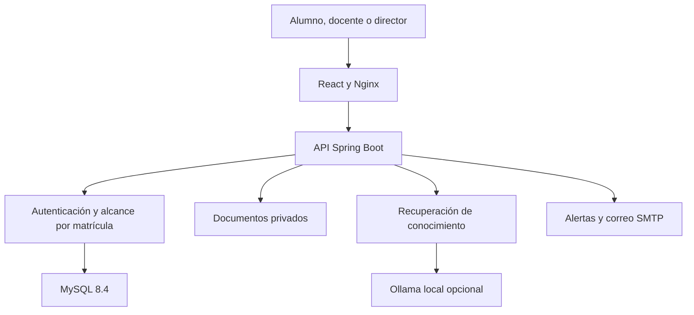
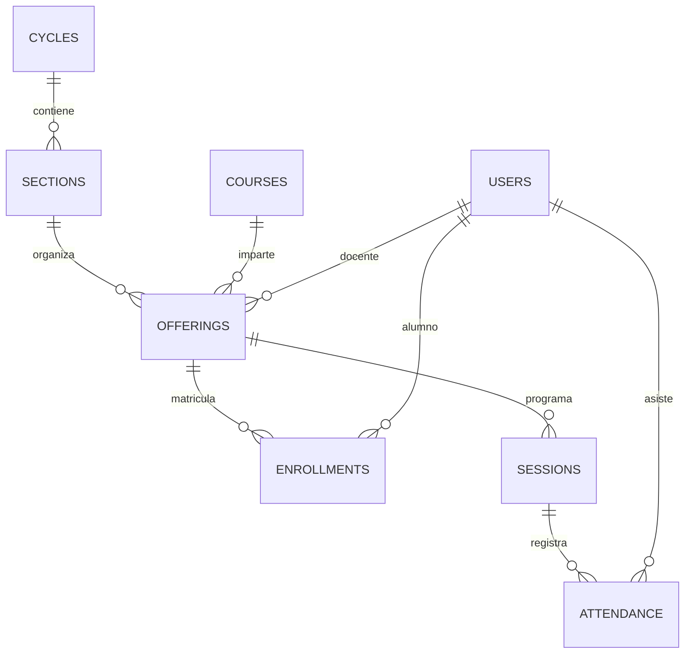
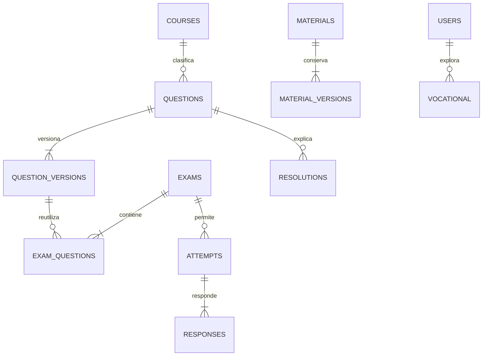

# Arquitectura y modelo de datos

## Componentes

Monolito modular: operaciones transaccionales y permisos centralizados, sin complejidad de microservicios prematura. React consume JSON y descarga archivos con el mismo token. Nginx resuelve rutas de la SPA y sirve como proxy de `/api`. MySQL conserva información académica y metadatos, el almacenamiento privado conserva archivos. Flyway controla cambios de esquema.

**Stack:** React 18, Vite, React Router, Recharts, Lucide; Spring Boot 3.5.6, Spring Security, JDBC; MySQL 8.4; PDFBox y Apache POI; cliente HTTP de Java para Ollama; cliente S3 opcional. Las versiones concretas están en `pom.xml` y `package-lock.json`.

## Entidades y relaciones

El DDL completo y ejecutable está en `backend/src/main/resources/db/migration/`. Los identificadores son UUID. Las fechas de calendario se guardan en ISO `AAAA-MM-DD` y los instantes UTC en ISO-8601; los horarios académicos se interpretan en Lima. El sistema admite varios ciclos simultáneos en una institución.

| Entidad | Propósito y relaciones |
| --- | --- |
| users | Cuenta con rol, estado, contraseña BCrypt, preferencias, tutor y constancia de consentimiento |
| auth_tokens | Sesiones de usuario; solo hash SHA-256 del token y vencimiento |
| settings | Nombre institucional, umbrales y pesos para nuevos ciclos |
| cycles | Inicio, fin calculado a 16 semanas, cierre y pesos propios del ciclo |
| sections | Sección perteneciente a un ciclo, nombre y capacidad |
| courses | Curso reutilizable entre ciclos y secciones |
| offerings | Curso + sección + docente explícitamente asignado; sílabo y avance |
| enrollments | Alumno + oferta académica; fecha de ingreso y retiro |
| sessions | Sesión de una oferta, fecha, horas, aula, tema y estado |
| attendance | Alumno + sesión, estado, observación y docente que registra |
| materials | Material de una oferta; autor, tema, dificultad y etiquetas |
| material_versions | Versiones inmutables: texto, enlace, archivo privado y motivo |
| questions | Identidad de pregunta de un curso, autor, tema y disponibilidad para práctica |
| question_versions | Enunciado, tipo, opciones, clave y explicación de cada versión |
| exams | Oferta, título, categoría, peso relativo, disponibilidad, tiempo, intentos y preferencias de simulacro |
| exam_questions | Versión exacta de pregunta, posición y puntaje dentro de un examen |
| attempts | Alumno + examen + número de intento, vencimiento, envío, estado y nota |
| responses | Respuesta de un intento a una pregunta del examen, puntos y retroalimentación |
| grades | Calificación manual por alumno/oferta, categoría, peso relativo y responsable |
| resolutions | Aporte a una pregunta, autor, contenido, versión y aprobación |
| resolution_history | Contenido histórico de las resoluciones modificadas |
| bulletins | Universidad, carrera, año, proceso, grupo de versiones, archivo o enlace |
| challenges | Oferta, creador, oponente, selección congelada de preguntas y vencimiento |
| challenge_results | Una entrega por usuario y reto, respuestas y puntuación |
| vocational | Alumno, versión de instrumento, respuestas, preferencias y resultado congelado |
| universities | Oferta orientativa, ciudad, fuente oficial, fecha de revisión y observaciones |
| notifications | Usuario, alerta, lectura, clave de deduplicación y estado de correo |
| chat_messages | Consultas/respuestas propias, fuentes y proveedor realmente utilizado |
| audit | Actor, acción, entidad, fecha y detalle del cambio |
| report_cards | Boleta institucional versionada, alumno, ciclo, emisor y fotografía de notas |

Los retos guardan una selección de versiones como JSON para preservar preguntas y claves de ese encuentro. La entrega al alumno elimina las claves hasta que ambos participantes terminen o el reto expire. Las boletas y los resultados vocacionales son fotografías del estado de emisión, no consultas que cambien retroactivamente.

## Reglas de cálculo

**Ciclo:** `fin = inicio + 16 semanas − 1 día`.

**Asistencia:** por alumno y oferta, `faltas / sesiones exigibles del ciclo × 100`. Las sesiones exigibles son las no canceladas entre el ingreso y el retiro, dentro del ciclo. `FALTA` incrementa el numerador; `JUSTIFICADO` no. El porcentaje «a la fecha» usa las sesiones realizadas, y no sustituye al porcentaje del ciclo. Es grave desde **50% inclusive**. La configuración preventiva admite 1–49%; no permite rebajar el límite grave. Es necesario programar el calendario completo para que el denominador del ciclo sea correcto. No se asume que 16 semanas equivalgan a 16 clases.

**Categorías:** PRACTICA, PARCIAL y SIMULACRO. Los pesos institucionales suman 100 y se copian al crear cada ciclo. Cada evaluación tiene un peso relativo positivo; el promedio de su categoría es `sum(nota × peso) / sum(pesos)`. Si un examen permite varios intentos, contribuye su mejor intento calificado y publicado. El promedio general usa los pesos de categoría; mientras falten categorías es provisional y se normaliza entre pesos disponibles. El promedio de ciclo promedia los cursos con igual peso.

**Evaluaciones:** el servidor impone ventanas, fecha de publicación, número de intentos y duración. La fecha límite es el menor valor entre cierre y comienzo + duración. El vencimiento se procesa al consultar y también por tarea periódica. Las preguntas objetivas se califican automáticamente, las de desarrollo quedan pendientes. Las notas se normalizan a 20.

**Conocimiento:** las versiones publicadas de preguntas se conservan; un examen usa la versión que se eligió al crearlo. El archivo lógico evita romper historiales. Las resoluciones editadas deben revisarse de nuevo.

## Seguridad y evolución

La autenticación usa tokens opacos aleatorios de ocho horas, almacenados en `sessionStorage` del navegador y como hash en el servidor. No se utiliza JWT. Suspender usuarios o cambiar contraseñas revoca sesiones. Los permisos se comprueban en la API sobre cada oferta y sobre la propiedad de cada intento, test, archivo o reporte; ocultar menús no es la defensa principal.

Los documentos se descargan a través de rutas autenticadas, nunca como carpeta pública. Consultas parametrizadas para entradas del usuario; las tablas de las utilidades JDBC proceden del código, no de parámetros HTTP. Autoguardado, envíos y calificación usan transacciones y bloqueo de filas donde se necesita evitar entregas duplicadas.

La implementación actual es para una institución y varias secciones/ciclos. Una ampliación a múltiples sedes requiere entidad sede y añadir su alcance a usuarios, ofertas, aulas y consultas; no se afirma aislamiento multiinstitución ya implementado. La recuperación de documentos es léxica; puede sustituirse por recuperación semántica sin cambiar el contrato del chatbot. La ejecución actual del planificador es para una instancia de backend; varias réplicas necesitan coordinación de tareas y límites compartidos.
