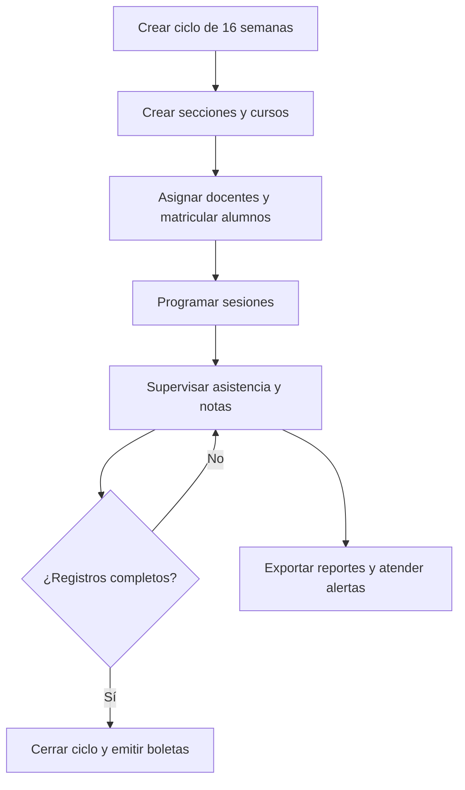
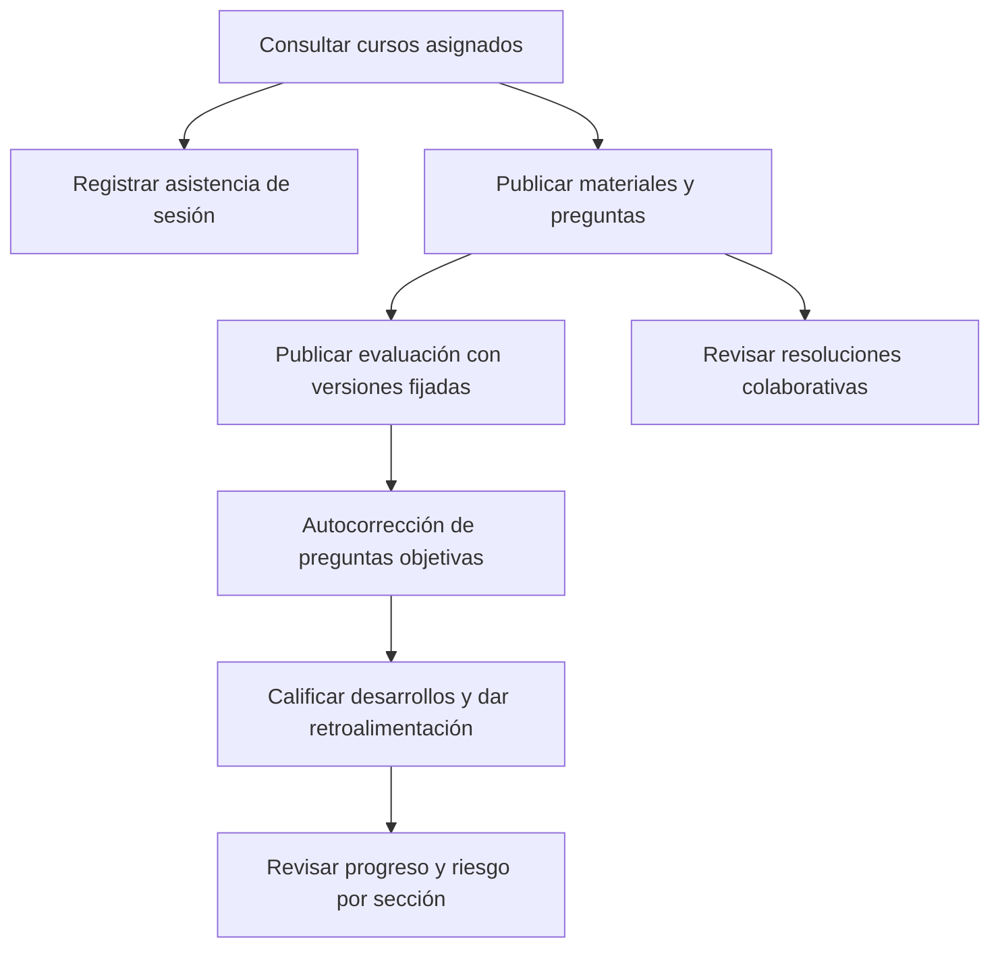
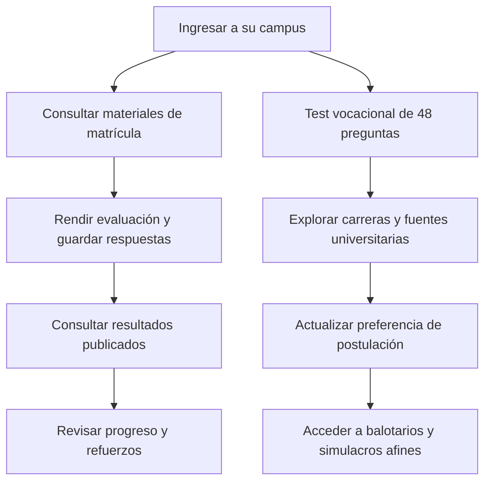
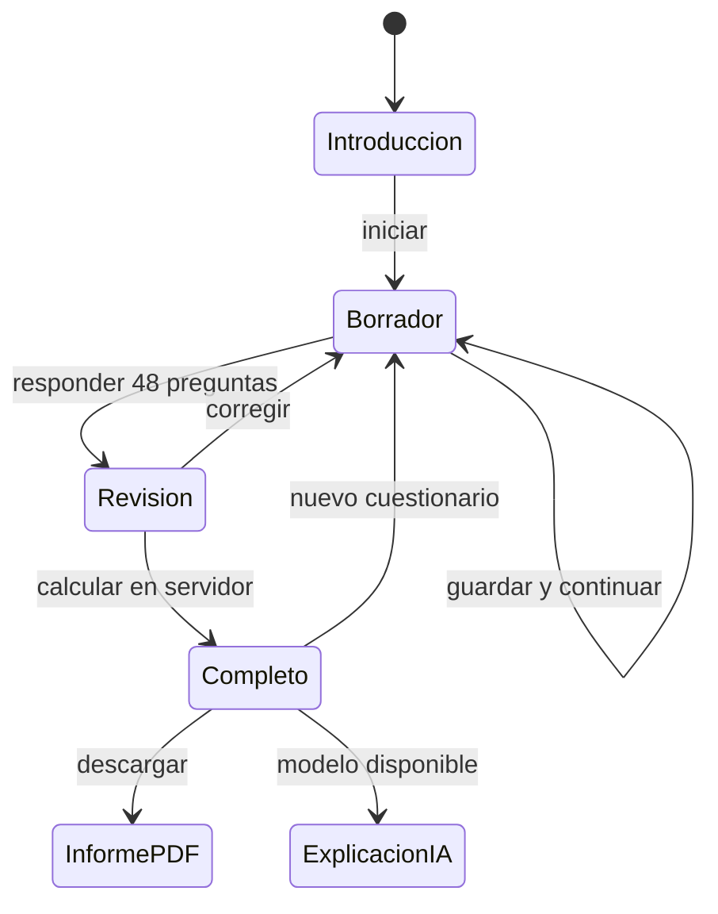

# Flujos de uso y pantallas

## Director

Inicio muestra métricas académicas, alumnos/docentes activos y notificaciones. Gestión académica organiza ciclos, secciones, cursos, asignaciones y matrícula en pestañas. Usuarios dispone de formularios y acciones de suspensión/retiro. Configuración conserva pesos, umbrales, fuentes universitarias y auditoría. Reportes combina filtros antes de descargar PDF o Excel. El director tiene acceso global dentro de la institución.

## Docente

Cursos presenta tarjetas por sección con promedio, asistencia, riesgo y avance. Horario permite programar repeticiones semanales, comprobar cruces y registrar los cuatro estados de asistencia. La biblioteca admite archivos o enlaces y muestra versiones. El editor de evaluaciones elige preguntas existentes, puntajes, peso relativo, tiempo, intentos y fechas. Calificación reúne entregas pendientes. Notas permite rectificar con motivo y dejar rastro de auditoría.

## Alumno

Inicio da prioridad visible a orientación vocacional. El alumno consulta sus cursos, biblioteca, evaluaciones, notas, asistencia y boletas. En Retos elige un compañero matriculado; las soluciones se liberan después de que ambos terminen o venza el encuentro. Resoluciones conserva aportes y estado de revisión. Perfil permite cambiar la carrera/universidad de interés y la contraseña.

## Test vocacional

La pantalla inicial explica propósito, duración aproximada y límites. El cuestionario usa bloques de seis preguntas, progreso, navegación y cinco opciones accesibles. El informe incluye gráfico de seis áreas, puntajes, empates, seis carreras afines, actividades exploratorias, universidades con fuentes y pasos siguientes. Historial permite comparar exploraciones personales realizadas en momentos distintos; no se usa como evaluación de admisión.

## Diseño implementado

Interfaz en español, fondo claro, navegación lateral azul, énfasis dorado para orientación vocacional, tarjetas de cursos, tablas, diálogos y estados de carga/error. En pantallas pequeñas la navegación se abre con un botón y las tablas permiten desplazamiento. Los formularios usan etiquetas, límites de campo y mensajes del servidor. Las fechas de instantes se muestran en la zona del equipo; los horarios de clase son los de Lima.

No se incluyen botones que produzcan reportes o resultados simulados: estas acciones llaman a la API. Las credenciales iniciales y el contenido de ejemplo sí son de demostración y deben reemplazarse por contenido institucional propio.
